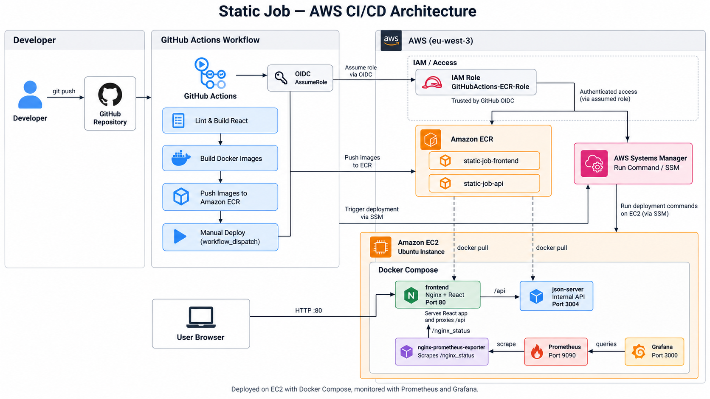
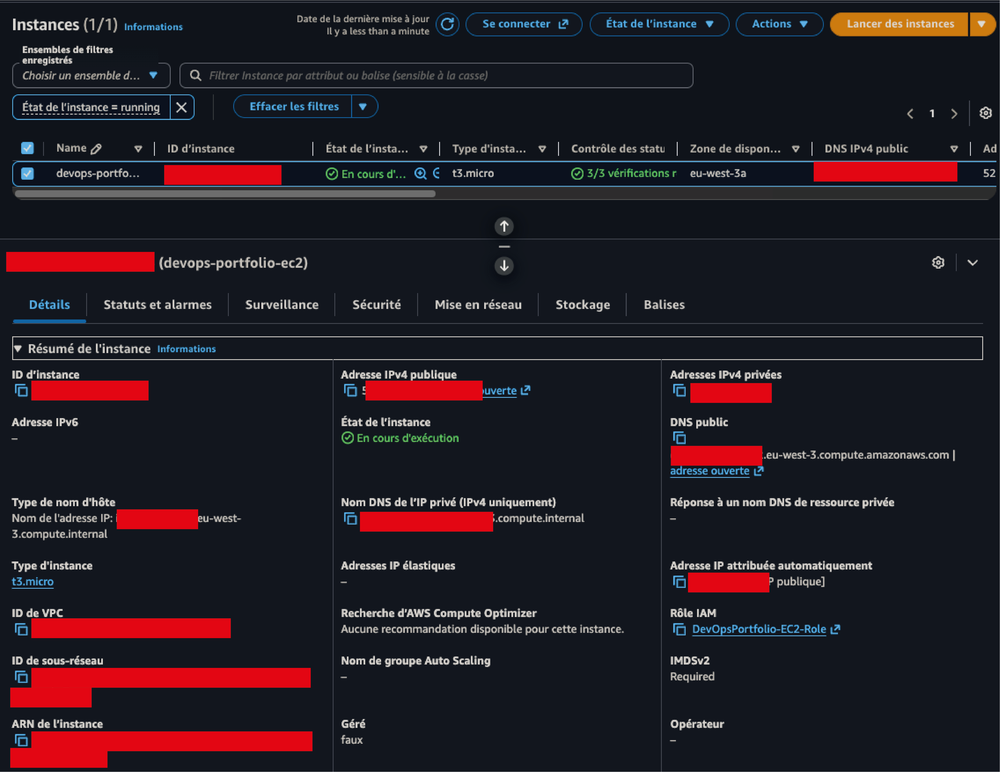
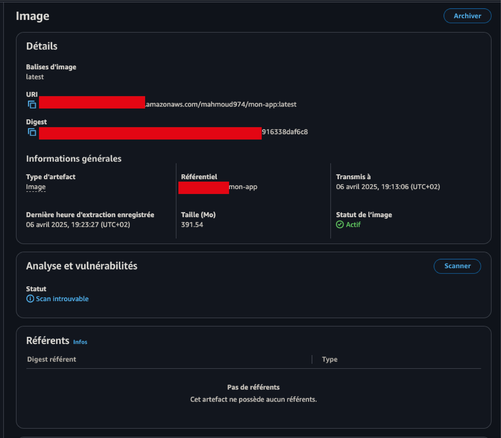
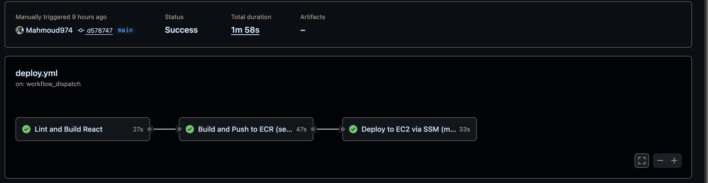
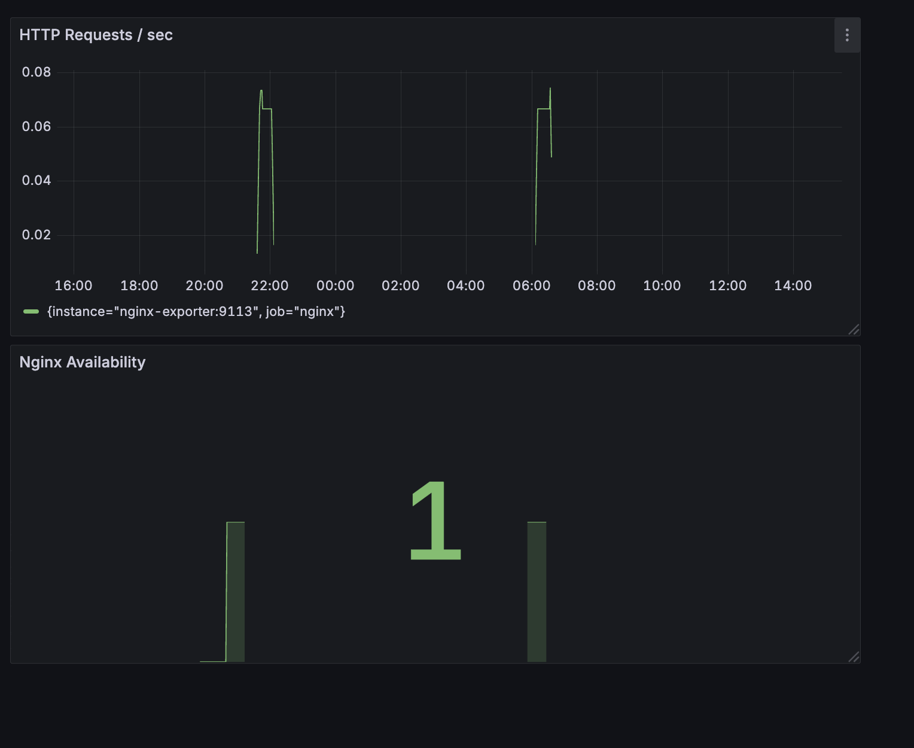
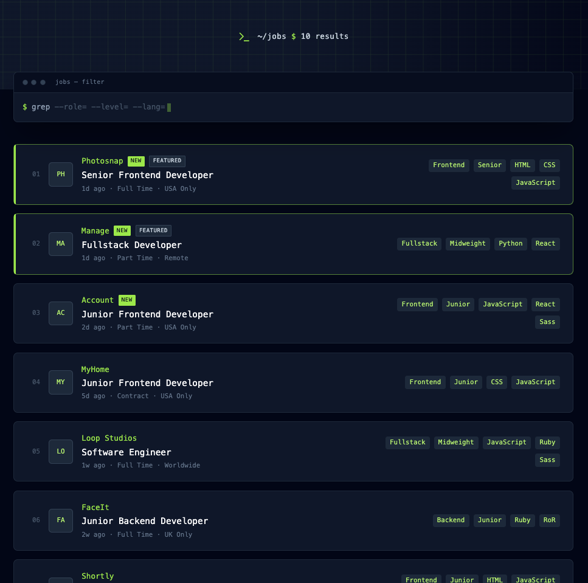

# Static Job — Déploiement AWS avec CI/CD et monitoring avec Terraform

## Présentation

Ce projet met en œuvre le déploiement d'une application composée de deux parties :

- **API (backend)** : service exposant les fonctionnalités et les données de l'application.
- **Frontend** : interface utilisateur consommant l'API.

Les deux projets ont été préparés sous forme d'images Docker et envoyés dans **Amazon Elastic Container Registry (ECR)** pour permettre leur déploiement sur **Amazon EC2**.

## Architecture



**Parcours de déploiement :**

1. Le code est hébergé sur **GitHub**.
2. **GitHub Actions** vérifie et construit l'application, puis crée les images Docker.
3. Les images `static-job-frontend` et `static-job-api` sont publiées dans **Amazon ECR**.
4. Le workflow de déploiement, lancé manuellement (`workflow_dispatch`), utilise **AWS SSM** pour exécuter les commandes sur EC2.
5. **Docker Compose** démarre les services sur une instance **EC2 t3.micro**.
6. **Prometheus** collecte les métriques et **Grafana** permet de les visualiser.

Le frontend **React** est servi par **Nginx** sur le port **80**. Nginx transmet les requêtes `/api` au service **JSON Server** sur le port interne **3004**.

## Technologies


| Domaine                | Technologies                                   |
| ---------------------- | ---------------------------------------------- |
| Frontend               | React, Nginx                                   |
| API                    | JSON Server                                    |
| Conteneurisation       | Docker, Docker Compose                         |
| CI/CD                  | GitHub Actions                                 |
| Cloud                  | AWS EC2, Amazon ECR, VPC, IAM, Systems Manager |
| Monitoring             | Prometheus, Grafana, Nginx Prometheus Exporter |
| Infrastructure as Code | Terraform (lecture seule, phase 1)             |


Les informations de l'instance EC2 :

- **Nom :** `devops-portfolio-ec2`
- **Type :** `t3.micro`
- **Région :** `eu-west-3` (Paris)
- **Zone de disponibilité :** `eu-west-3a`
- **Contrôles de statut :** 3/3 réussis
- **Adresse IPv4 publique :** présente sur la capture, volontairement non publiée ici
- **Rôle IAM associé :** `DevOpsPortfolio-EC2-Role`



### Amazon ECR

Amazon ECR sert de registre privé pour les images Docker utilisées lors du déploiement. 



## CI/CD

Le pipeline automatise la construction et la publication des images Docker, puis leur déploiement sur l'instance EC2 via SSM. L'accès AWS de GitHub Actions repose sur une **assomption de rôle IAM via OIDC**, sans clé AWS statique dans le workflow.



**Fichier de déploiement :** `.github/workflows/deploy.yml`.

## Monitoring

Le suivi de l'application repose sur **Prometheus**, **Grafana** et un **exporter Nginx**. Le tableau de bord permet notamment d'observer :

- le taux de requêtes HTTP par seconde ;
- la disponibilité de Nginx.

Exemple de requête PromQL utilisée :

```promql
rate(nginx_http_requests_total[5m])
```



## Terraform — phase 1 : lecture seule

Le dossier `terraform/` permet **d'inspecter l'infrastructure AWS existante**, sans la créer, la modifier ou la supprimer. Il utilise uniquement des **data sources** pour consulter :

- l'instance EC2, le VPC et le subnet ;
- les dépôts ECR `static-job-frontend` et `static-job-api` ;
- les rôles IAM `DevOpsPortfolio-EC2-Role` et `GitHubActions-ECR-Role`.

## Sécurité

- **OIDC + IAM** pour l'authentification du workflow auprès d'AWS.
- **SSM** pour exécuter les commandes de déploiement sans ouvrir un accès SSH à GitHub Actions.
- **ECR privé** pour stocker les images Docker.
- **IMDSv2 requis** sur l'instance EC2.
- Rôle EC2 disposant notamment des politiques `AmazonEC2ContainerRegistryReadOnly` et `AmazonSSMManagedInstanceCore`.

**Attention :** l'application est illustrée ici en **HTTP sur le port 80**, sans preuve d'un chiffrement HTTPS en frontal. Pour une exposition publique durable, prévoir HTTPS, la restriction des accès de monitoring et un durcissement réseau adapté.

Ne jamais publier `terraform.tfvars`, les fichiers `*.tfstate`, les clés AWS ou d'autres secrets. Le fichier `.terraform.lock.hcl` peut être versionné.

## Évolutions possibles

- Importer progressivement les ressources existantes dans l'état Terraform afin de passer à une infrastructure réellement gérée en IaC.
- Ajouter un nom de domaine et HTTPS.
- Renforcer la supervision avec des alertes et des indicateurs de santé applicative.
- Améliorer la disponibilité et la stratégie de sauvegarde du déploiement.

---

**Objectif du projet :** démontrer un déploiement de bout en bout sur AWS, depuis le code source jusqu'à l'exploitation d'une application conteneurisée, avec CI/CD, contrôle des accès et monitoring.


## Aperçu de l'application

Interface web **Static Job** développée avec React, permettant de consulter et de filtrer des offres d'emploi selon différents critères (poste, niveau d'expérience et technologies).

